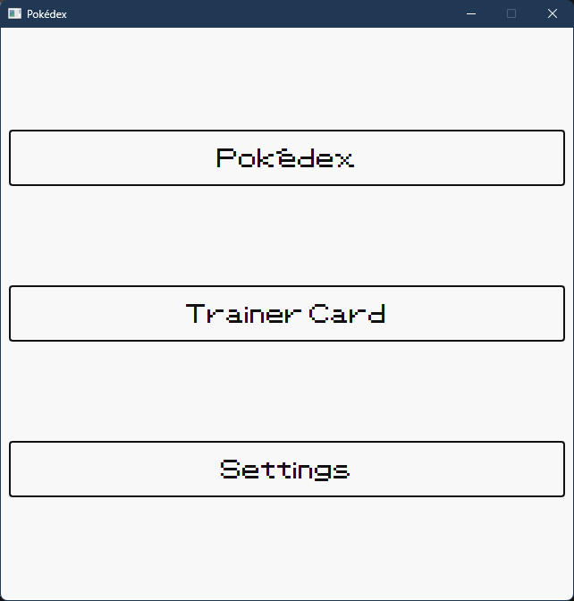
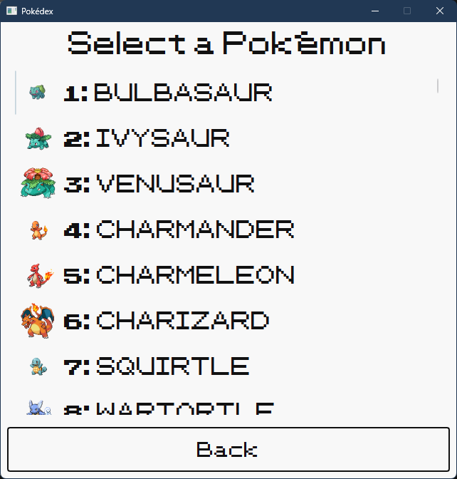
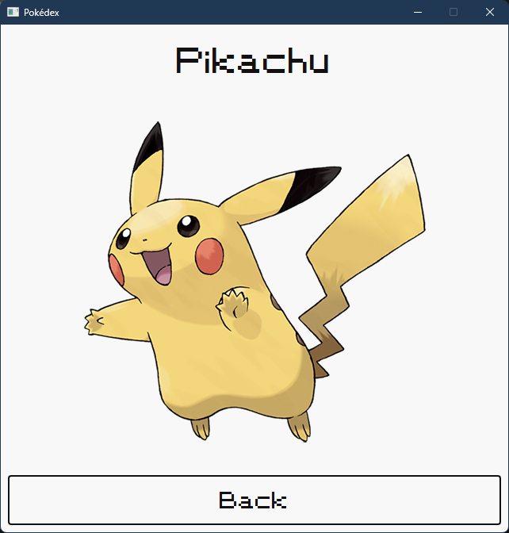

# Raspberry Pi Pokédex Project

This project aims to create a fun and interactive Pokédex application using a Raspberry Pi Zero 2 W and a small TFT display. The Pokédex allows users to browse through all 151 Generation 1 Pokémon, view their details, descriptions, shiny sprites, and evolutionary lines, and track their "caught" progress offline.





## Project Goals

- Develop a user-friendly Pokédex application with a graphical interface.
- Display Pokémon sprites, shiny sprites, official artwork, names, types, descriptions, and evolutions.
- Allow users to navigate through the Pokédex using keyboard or hardware GPIO buttons and select Pokémon to view their details.
- Implement a dynamic "Trainer Card" feature to personalize the experience and track caught Pokémon and badges.
- Provide customizable settings including Light Mode and Dark Mode themes.
- Run the application offline on a Raspberry Pi Zero 2 W with a small TFT display.

## Current Progress

- **Database (`database/`):**
  - Designed an SQLite database (`database/pokedex.db`) defined in `database/create_tables.sql` with `pokemon`, `evolutions` (`UNIQUE(from_pokemon, to_pokemon)`), and `trainers` tables.
  - Built a unified, cross-platform seeding script (`database/seed_database.py`) using `pathlib.Path` that populates all 151 Generation 1 Pokémon, cleaned English Gen 1 flavor text descriptions, evolution chains, and a default trainer row in a single SQLite transaction.
  - Downloaded and cached all 151 small list sprites (`images/pokemon/sprites/`), shiny sprites (`images/pokemon/shiny/`), and large official artwork (`images/pokemon/large/`) for offline use.

- **Application Interface (`src/`):**
  - Developed a multi-page PyQt6 interface (`src/main.py`) with cross-platform path resolution anchored to `BASE_DIR`.
  - **`MainMenu`:** Navigation hub for Pokédex, Trainer Card, and Settings.
  - **`PokedexPage`:** Scrollable list of all 151 Pokémon with sprite icons, using `itemActivated` so Up/Down arrow keys (and future GPIO buttons) scroll smoothly without auto-opening entries.
  - **`PokemonPage`:** Single reusable detail page (preventing widget and database connection leaks) displaying the Pokémon ID, name, official artwork, shiny sprite, Type1/Type2 badges, word-wrapped Pokédex description, clickable evolution navigation buttons, and a persistent "Caught" toggle button saved directly to SQLite.
  - **`TrainerCardPage`:** Dynamically queries `trainers` (`trainer_name`, `badges_earned`) and the live count of caught Pokémon (`SELECT COUNT(*) FROM pokemon WHERE caught = 1`) whenever the page is shown (`showEvent`).
  - **`SettingsPage`:** Includes a Light Mode / Dark Mode switch that dynamically toggles between `src/styles.qss` and `src/dark_styles.qss`.
  - Applied retro pixel styling using the custom `PKMN RBYGSC` font (`src/fonts/PKMN_RBYGSC.ttf`).

- **Testing (`testing/`):**
  - Added an automated `pytest` test suite (`testing/test_pokedex.py`) verifying the SQLite schema and constraints, flavor text cleaning and database seeding, `caught` state persistence, dynamic `TrainerCardPage` updates, Light/Dark theme switching, and leak-free page navigation.

- **Hardware Integration:**
  - (In progress) Plan to integrate with Raspberry Pi GPIO buttons for navigation and a small speaker for sound effects.

## Next Steps

- Add badge management and trainer name customization UI to the `TrainerCardPage` / `SettingsPage`.
- Expand `SettingsPage` with sound/volume controls and display preferences.
- Implement Raspberry Pi GPIO button bindings and speaker audio for Pokémon cries.
- Design and 3D print an enclosure for the Raspberry Pi Zero 2 W and TFT display.
- Benchmark and optimize startup and rendering performance on the Raspberry Pi Zero 2 W.

## Repository Structure

- `database/`: SQLite schema (`create_tables.sql`), unified seeding script (`seed_database.py`), and the SQLite database (`pokedex.db`).
- `docs/`: Screenshots and documentation assets.
- `images/`: Cached Pokémon list sprites (`pokemon/sprites/`), shiny sprites (`pokemon/shiny/`), official artwork (`pokemon/large/`), and trainer card images (`trainers/`).
- `src/`: PyQt6 application (`main.py`), Light/Dark stylesheets (`styles.qss`, `dark_styles.qss`), and custom font (`fonts/PKMN_RBYGSC.ttf`).
- `testing/`: Automated `pytest` suite (`test_pokedex.py`) and sample SQL queries (`evolutions_query.sql`).
- `LICENSE`: License file.
- `readme.md`: Project documentation.
- `.gitignore`: Git ignore rules for virtual environments, caches, and build artifacts.

## Requirements

This project is built with Python 3.13 and PyQt6.

1. Install dependencies:
   ```bash
   pip install -r requirements.txt
   ```

## Running the Application

1. Clone this repository.
2. *(Optional)* Seed or refresh the database and local images:
   ```bash
   python database/seed_database.py
   ```
3. Launch the Pokédex application (can be run from any working directory):
   ```bash
   python src/main.py
   ```

## Running Tests

Run the unit test suite with `pytest`:
```bash
pytest
```

## License

Pokémon and Pokémon character names are trademarks of Nintendo and Game Freak.

## Acknowledgements

- Special thanks to [PokéAPI](https://pokeapi.co/) for providing the data and images used in this application.
- Inspiration from various online resources, including Pokémon fan communities and game guides.
- This project was developed with assistance from Gemini.
